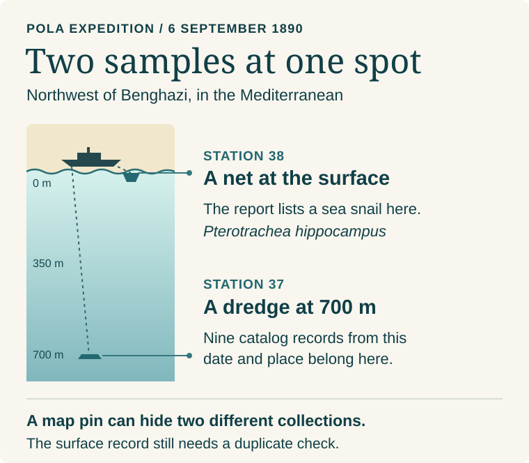

# Marine Ledger

This is an experiment in iteratively building pipelines for open-world discovery with frontier language models. Agents read historical expedition reports, trace observations to the printed pages, and test whether catalogs already represent them. When a reading task repeatedly fails, we benchmark a specialist model against OCR on a different expedition before using it to generate new records.

**What a missing letter costs.** On the first four complete pages from a new expedition, both automatic readers turned *Siboga* station 49A into 49. The ship's log puts those collections 300 metres apart in depth. TrOCR on Grace recovered 31 of 37 printed station mentions, and Tesseract recovered 32. Luna and the catalogs helped distinguish reading errors from genuinely unresolved questions about specimen identity. [Illustrated Siboga result](experiments/full-page-transfer/README.md) · [How we investigate disagreements](experiments/full-page-transfer/DISAGREEMENTS.md)

**Two samples at one spot.** In 1890 the *Pola* took a surface sample and a 700-metre dredge at the same printed coordinates. A modern catalog search returns nine records for the deep operation. To find out what the crew caught at the surface, we had to join the species account to the original station log. [Read the illustrated field note and see the two source pages](explainers/two-stations.md)



**How well can an AI read the station log?** TrOCR with published weights read 60/67 Ingolf identifiers and 31/31 Challenger identifiers on Grace. The best Tesseract setting read 47/67 and 27/31. Two Luna subagents each read 61/67 and 31/31, including six identical errors on the faint Ingolf page. This result supports trying the pretrained reader on a new report before fine-tuning. [See a shared reading error and all five results](experiments/grace-reader/pretrained/README.md) · [Earlier trained model and sealed test](experiments/grace-reader/README.md)

Can a published collection event be recovered from a historical expedition report and reconciled with modern marine records? This pilot starts with one ship, the *Pola*, and two reports from its eastern Mediterranean voyages. Sturany’s 1896 report has a modern digitization for calibration. Oberwimmer’s 1898 report supplies an adjacent search for pelagic molluscs. [BHL volume](https://www.biodiversitylibrary.org/item/100795) · [MedOBIS digitization](https://doi.org/10.25607/mu0n0i)

**First run, 25 November 2026.** The extractor linked all eight printed species–station associations on the evaluation page to their expected OBIS records. It rejected two comparison species on that page and an explicit subfossil on the development page. On two pages by the second author, the species accounts and station table agreed on four historical name–station assertions. Current taxonomy groups them into **three reviewable cases**. Each is a published occurrence awaiting duplicate review. The pilot reached these results with local computation and public data access. [Control ledger](results/calibration.json) · [Candidate table](results/candidates.tsv) · [Evidence packets](results/review_packet.json)

| Pola station | Surface net on 6 September 1890 | What remains open |
|---|---|---|
| 38 | *Pterotrachea hippocampus* | OBIS has nine mollusc records at this date and location from **station 37**, a 700 m dredge. The scan assigns the surface-net sample to station 38. |
| 41 | *Pterotrachea coronata* | The printed table and account agree. A museum accession or duplicate publication could resolve whether a modern record already represents this event. |
| 41 | *Pterotrachea hippocampus* and *P. mutica* | WoRMS lists *mutica* as an **uncertain synonym** of *hippocampus*. The queue groups the two names by accepted ID and preserves both originals. The source gives no specimen count. |

[Printed station table](https://www.biodiversitylibrary.org/page/32372996) · [Printed species accounts](https://www.biodiversitylibrary.org/page/32373005) · [WoRMS synonym status](https://www.marinespecies.org/aphia.php?p=taxdetails&id=238124)

## Reproduce

An additional six-page benchmark tests the extractor against scan-verified station numbers and identifies a specific target for a specialist model. German OCR and two parsing changes recovered 39 of 53 pairs on the three subsequent pages, up from 23 with the original pipeline. [Benchmark, errors and Grace experiment](experiments/station-extraction/README.md)

Python 3.10+ on macOS or Linux and the standard library suffice. From the repository root, run the following.

```sh
python3 pilot.py replay --out results
make verify
python3 agents/review.py plan --limit 3
```

Replay verifies all 15 input hashes. It checks calibration before admitting exploration cases. A calibration mismatch writes an empty packet and returns a failing exit status. The output TSV uses Darwin Core field names where possible. Its local IDs group taxon and station for review. It preserves the printed date, coordinates and sampling method. Geodetic datum and museum catalog number are unknown. [Input manifest](data/source/manifest.json) · [Review worker and API budget](agents/README.md)

To fetch current versions of the same bounded evidence into a **new** directory, run one fetch at a time. The four OBIS requests execute serially. An advisory lock prevents overlapping fetch jobs in this checkout. Each result must fit on its single 500-row page, with the returned count matching the reported total. A truncated response stops the run. For a larger search, OBIS provides bulk GeoParquet. [OBIS access guidance](https://obis.org/data/access/)

```sh
python3 pilot.py fetch --out /tmp/pola-new-snapshot
python3 pilot.py replay --source /tmp/pola-new-snapshot --out /tmp/pola-new-results
```

Keep new snapshots and their results together. Compare the manifests and review any scientific changes before updating the reference. A changed scan requires a fresh check of its transcription.

## How the pilot was scored

* The parser reads numbered species accounts with an explicit German station line. It strips parenthesized depth measurements before reading station numbers. An investigator transcribed station-table rows separately from the page images. Extending this parser to other formats requires fresh controls.
* Sturany p. 8 is the development page. Its OCR reads station 218 where the scan reads **213**. A documented page-specific correction preserves the original OCR. The development ledger also retains an unmatched dead-shell record from station 214 and a subfossil with an OBIS entry. Biological presence at collection time would require stronger evidence. [Correction](data/ocr-corrections.json) · [Scan](https://www.biodiversitylibrary.org/page/32372963)
* On p. 9, the extractor makes predictions without the expected IDs. The scorer requires equality with the entire preselected page’s eight taxon, station and OBIS occurrence ID triples. A comparison from Pernambuco and a cited fossil species must both stay out of the extracted events. The label-separated page is a small engineering benchmark selected during development. It gives no population estimate of extraction accuracy. [Answer key](data/control-key.json) · [Evaluation page](https://www.biodiversitylibrary.org/page/32372962)
* The exploration cohort consists of *Pterotrachea* entries at stations **38 and 41** on Oberwimmer’s table p. 5. Page 14 gives independent text in the same report, including an explicit statement that the animals were not found in the Adriatic on these expeditions. The two pages corroborate the reported event within one source. WoRMS resolves the three names. Distinct specimens, vouchers and abundance remain unknown. [Station transcriptions](data/station-transcriptions.json)

## Duplicate checks and follow-up

| Cached OBIS request | Rows | Interpretation |
|---|---:|---|
| All occurrences in the curated 1896 *Pola* dataset | 292 | Positive comparison for Sturany. Its stated scope covers the first report. |
| Pterotracheidae worldwide, 1885–1900 | 25 | The records come from Villefranche-sur-Mer and the South Atlantic. None localizes to either candidate station. |
| Pterotracheidae, 18–22° E and 31–34° N, unrestricted date | 0 | Broadens the time and name search around both stations. |
| All taxa, same rectangle, 6 September 1890 | 9 | All nine come from the same co-located dredge, station 37. |

Each response was complete for its request on the snapshot date. Misdated, unlocated, misidentified or undigitized holdings can escape these filters. The family-wide geographic search can also miss historical longitudes expressed relative to other meridians. The two printed Pola positions are used as reported. [Exact query URLs and counts](results/coverage.json)

A second reviewer searched GBIF. At station 38, a date-and-coordinate match alone would merge separate surface and seabed samples. The same MedOBIS collection contributes records to both aggregators. The Vienna museum’s public Mollusca search returned 199 entries in total and zero genus-text hits. Its collection histories identify both expedition and Oberwimmer material. The most discriminating next check is a register or lot label naming the original taxon, station and gear. [GBIF review](review/catalog-check.md) · [Vienna collection search](review/museum-check.md)

For the next tranche, retain a fresh control page, extract its associations before opening the comparator, and compare all additions and omissions. Then extend to the remaining stations on p. 14 using their corresponding station-table rows. Track reviewed cases, duplicate rejections, cases surviving both page checks, and minutes of expert review. Publishable rows would require verification by a domain reviewer and an appropriate data node. [Agent protocol](AGENTS.md) · [Contributing records to OBIS](https://obis.org/data/contribute/)

## Source credit

* Rudolf Sturany (1896) and Alfred Oberwimmer (1898), *Pola* expedition mollusc reports, Smithsonian Libraries collection. The BHL item metadata identifies the work as public domain. Four original JPEG 2000 scans and four raw OCR pages are cached from BHL open data. Source URLs, hashes and access date accompany the files. [BHL volume](https://www.biodiversitylibrary.org/item/100795) · [BHL source metadata](https://archive.org/download/polaexpeditionmo00wien/polaexpeditionmo00wien_bhlmets.xml) · [BHL open data](https://github.com/gbhl/bhl-open-data)
* Dimitra Mavraki, Ioannis Rallis and Melina Loulakaki (2024), digitization of the *Pola* expedition molluscs, HCMR / MedOBIS, CC BY 4.0. Selected fields were downloaded through OBIS. [Publisher and DOI](https://doi.org/10.25607/mu0n0i)
* Olivier, Lilley, Lombard and Stemmann (2015), historical Villefranche-sur-Mer surface observations, and the Smithsonian NMNH Invertebrate Zoology Collection Database supply the worldwide family comparison. Both datasets are licensed CC BY 4.0. [Villefranche dataset](https://obis.org/dataset/cf2113ef-d5f0-4586-9fc6-4b208e0bc245) · [NMNH dataset](https://obis.org/dataset/89e23fc8-3f61-4480-9de3-358fe6eefe0b)
* MolluscaBase editors (2026), records accessed through the World Register of Marine Species. Full citations and accepted AphiaIDs are retained in the original responses. [*P. coronata*](https://www.marinespecies.org/aphia.php?p=taxdetails&id=139944) · [*P. hippocampus*](https://www.marinespecies.org/aphia.php?p=taxdetails&id=139945) · [*P. mutica*](https://www.marinespecies.org/aphia.php?p=taxdetails&id=238124)
