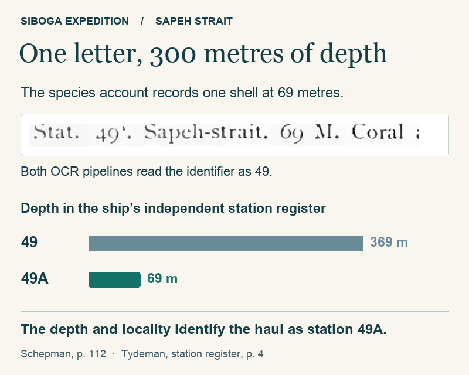
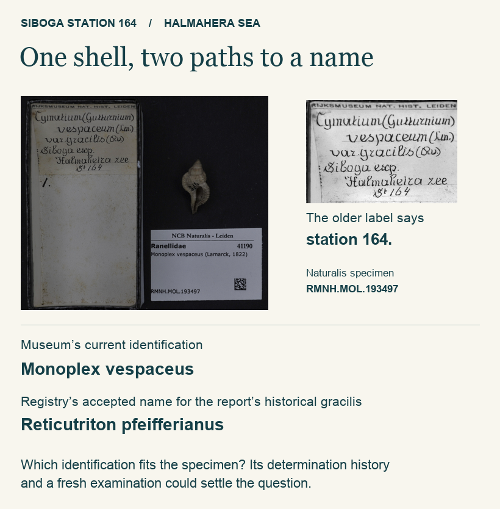

# One letter, 300 metres of depth

Where did the *Siboga* collect a shell in Sapeh Strait? Two automatic readers produced station **49**. Schepman’s species account reports a depth of 69 metres. The ship’s separately published register lists station 49 at **369 m** and station **49A at 69 m**. The register and the small raised character in the scan identify the shallower operation. A single OCR character would have assigned the shell to a different habitat. [Species account, p. 112](https://www.biodiversitylibrary.org/page/2205139) · [Station register, p. 4](https://archimer.ifremer.fr/doc/00000/4745/4237.pdf#page=164)



## What changed on full pages

We froze four consecutive pages, 110–113, of Schepman’s 1909 gastropod report from the 1899–1900 Siboga Expedition. This expedition had supplied no calibration pages. Tesseract located text on every complete scan. We ran the previously selected TrOCR weights on Grace on every one of the 497 short segments in 156 detected lines. Each pipeline extracted station mentions from its own reassembled text. An independent worker kept all reference boxes and transcriptions sealed while these predictions were produced. On a previously seen Challenger calibration page, both methods found all three known station headings. [Source edition and reconstruction](corpus/README.md) · [Frozen protocol](PROTOCOL.md) · [Prediction commitment](https://github.com/harsh-kumar9/marine-ledger/commit/80b99f1)

| Full-page output | Proposed mentions | Correct, in place | Recall across 37 mentions | Correct numbered mentions in named-species material |
|---|---:|---:|---:|---:|
| Tesseract | 34 | 32 | 86.5% | 29 / 32 |
| Frozen TrOCR | 33 | 31 | 83.8% | 28 / 32 |

The full set includes 32 mentions in named-species collections, four in genus-only material, and one repeat in descriptive prose. Tesseract recovered one mention TrOCR missed, the printed digit 1 read by TrOCR as the letter I. Every correct TrOCR mention was also correct in the baseline. Both missed 43 after page segmentation cut off its station marker, split 77 across lines, lost the suffix of 49A, and skipped two numbers in a prose list where “Stat.” appeared only once. These errors localize the next experiment to page layout and list parsing. On isolated crops TrOCR had read 31/31 Challenger identifiers. An end-to-end pipeline on a new book poses a different test. [Paired results](results/scores.json) · [Full-page transcriptions](results/readings.jsonl) · [Earlier crop test](../grace-reader/pretrained/README.md)

## What the different readings reveal

The original authors published these collections, and libraries and taxonomic catalogs have digitized much of their work. The hard step is preserving what one particular shell, haul and identification meant. At station 37, two separate and qualified historical headings now lead to the same accepted name, *Monoplex vespaceus*. Each describes one specimen. A database grouped by accepted species and station could collapse both into one entry. At station 164 a second pair of historical names also maps to one accepted species. Distinct printed assertions are evidence to retain while specimen identity remains open. [Account on p. 111](https://www.biodiversitylibrary.org/page/2205140) · [Account on p. 112](https://www.biodiversitylibrary.org/page/2205139) · [Taxonomic and occurrence packets](catalog/packets.json)

**A museum label changed the result.** Catalog searches by the modern name and expedition did not bring back a shell from station 60. A direct search of the Naturalis collection led to a photographed label naming the ship, station 60, Haingsisi and the historical variety. At station 164 another label confirms the station, but Naturalis and the taxonomic registry point to different modern names. The report lists four shells under the historical heading and the museum holds one. A researcher can now target a specific specimen and its identification history. [Station 60 label](https://medialib.naturalis.nl/file/id/RMNH.MOL.193059/format/large) · [Station 164 specimen](https://data.biodiversitydata.nl/naturalis/specimen/RMNH.MOL.193497) · [Competing interpretations](DISAGREEMENTS.md#when-a-photograph-adds-a-missing-station)



Specimen photograph courtesy of Naturalis Biodiversity Center, CC0 1.0. The enlarged detail comes from the same photograph. [Original photograph](https://medialib.naturalis.nl/file/id/RMNH.MOL.193497/format/large) · [Rights and media metadata](https://api.biodiversitydata.nl/v2/multimedia/find/RMNH.MOL.193497@CRS)

A Luna investigator read all four scans before seeing the key or catalogs. Across the 32 named-species station mentions, it listed 31 exact station identifiers in the corresponding account. That count evaluates station numbers with the headings aligned afterward. It gives no credit for spelling accuracy or accepted taxonomy. Its initial page read also dropped the suffix of 49A and misread the doubtful *vespaceus* heading. Conversely, its *pilearis* reading exposed a one-letter error in the sealed reference. The public ledger preserves the source readings and the correction. [Independent first read](review/luna-scan.json) · [Correction](review/errata.json) · [Station-level comparison](review/station-ledger.jsonl)

Luna then checked **all 14 historical accounts** against the page images, modern name and occurrence queries, the station register, and the relevant museum specimens and labels. **Five of 32 named collection assertions have a photographed museum voucher linked to the printed station and historical identification.** They cover stations 1, 2, 60, 164 and 234. **All five vouchers already have GBIF records.** Looking them up by the museum specimen IDs found all five; the GBIF records lack event date, field number and event ID. The expedition-keyword search had returned zero for those taxa. This is a measured retrieval gap with a known answer. At stations 1 and 2 the old museum tickets preserve the name and author in the book while the museum uses a different current name. At 234 the book reports one shell and the museum records two. At 164 the four printed shells, one museum shell and two modern identification paths remain separate. The other 27 named assertions have no station-level voucher identified by these checks. The search covered specified online collections, name variants and metadata fields. [All 14 Luna decisions](review/luna-catalog.json) · [Provider IDs and corresponding GBIF records](catalog/museum.json) · [Five label transcriptions](catalog/label-readings.json) · [Row-level evidence](review/station-ledger.jsonl)

One detail needed a further source check after Luna’s audit. The station 60 museum ticket gives 36 m, Schepman’s row on p. 111 gives no depth, and the commander’s register lists 23 m with shallow *Lithothamnion* habitat. The matching expedition, station, locality and variety establish the association. The depth of that particular specimen remains unresolved. [Register cross-checks and limits](catalog/voucher-stations.md)

The comparison also surfaced a catalog issue outside these four pages. A positive control links a Siboga specimen to station 89 in both OBIS and GBIF. The ship’s register leaves its coordinates blank. The catalog coordinates resemble those of the preceding station with the opposite latitude sign. A later georeference could account for them. The specimen label or catalog’s georeferencing history would distinguish the explanations. [Disagreements and discriminating checks](DISAGREEMENTS.md) · [Control packet](catalog/control.json)

## Reproduce

From this directory the existing predictions can be scored with Python’s standard library.

```sh
python3 corpus/verify.py
python3 score.py > /tmp/siboga-scores.json
diff results/scores.json /tmp/siboga-scores.json
python3 casebook.py
```

To rerun inference, use Tesseract 5.1.0, English LSTM, PSM 3; the exact PNGs and selected Tesseract layouts are committed. Use the model weights from the [frozen checkpoint downloader](../grace-reader/pretrained/fetch.py). The [control](control/runtime.json) and [transfer](results/runtime.json) receipts record the file hashes, software and device. Grace jobs 520871 and 520875 completed in 26 and 45 seconds respectively on one NVIDIA RTX A6000. The scorer requires each reference center to fall inside a segment with the right station number. Each prediction can count once.

```sh
python3 layout.py corpus/pages.jsonl /tmp/siboga-layout.jsonl
HF_HUB_OFFLINE=1 python3 read_pages.py corpus/pages.jsonl /tmp/siboga-layout.jsonl /path/to/weights /tmp/siboga-run
python3 extract.py /tmp/siboga-layout.jsonl /tmp/siboga-run/readings.jsonl /tmp/siboga-stations.jsonl
python3 score.py --predictions /tmp/siboga-stations.jsonl
```
