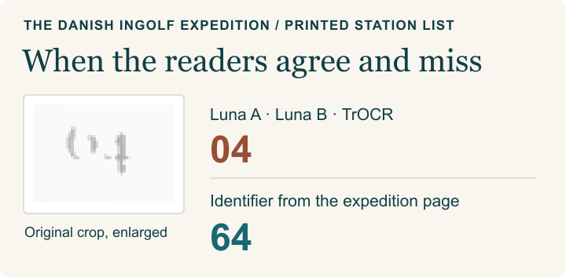

# Can an off-the-shelf model read an expedition's station numbers?

**Yes on these two excerpts.** On the Danish *Ingolf* list, Microsoft's printed-line TrOCR read 60 of 67 station identifiers correctly. The best previously tested Tesseract setting read 47. On the *Challenger* report, the same models read 31 and 27 of 31. Each input was a cropped field. Recovering a usable observation also requires finding the field on a full page, identifying the animal and checking the station log.

| Reader | Ingolf exact / 67 | Ingolf character edits / 125 characters | Challenger exact / 31 | Challenger character edits / 94 characters |
|---|---:|---:|---:|---:|
| Tesseract, validation-selected single-line setting | 47 | 28 | 27 | 5 |
| English PaddleOCR, published weights | 49 | 24 | 31 | 0 |
| Microsoft TrOCR small printed, published weights | **60** | **9** | **31** | **0** |
| Luna visual reader A | 61 | 7 | 31 | 0 |
| Luna visual reader B | 61 | 7 | 31 | 0 |

The two GPU readers saw each original field separately. Two fresh Luna subagents each received the same seven shuffled visual sheets without labels or model outputs. They made identical readings on all 98 fields. A difference of one correct field on Ingolf gives little basis for ranking TrOCR and Luna across books. The two Luna runs share a model, and their presentation allowed multiple enlarged crops to be visible together. [Reader instructions, contact sheets and raw outputs](../luna/README.md) · [Per-reader scores and paired errors](results/scores.json)



**Why a second reader can still be wrong.** Both Luna runs read the six consecutive Ingolf identifiers 62–67 with a leading zero. TrOCR independently produced the same incorrect answer on three of those six, including 64 → 04. A vote would have reinforced that error. In the full table a reader can inspect the field in its printed sequence. The station list and a record of the source page therefore remain part of the evidence for a proposed observation. [Original Ingolf page](https://archive.org/details/danishingolfex3cpt8daniuoft/page/n114/mode/1up) · [Shared mistakes by crop ID](results/scores.json)

**Model choice.** TrOCR won the prespecified comparison between the two Hugging Face checkpoints on Ingolf. It recovered all four Challenger fields missed by single-line Tesseract, including 122B, which Tesseract read as 122P. Both checkpoints met the threshold for deferring training. Use frozen TrOCR as the specialist in the next experiment. Reserve a new expedition before changing the cropper, decoding or weights. Challenger’s answer key and earlier scores were already public when we chose these readers. This was a retrospective comparison, and overlap with the original model providers’ training material is unknown. [Protocol committed before inference](PROTOCOL.md) · [Earlier sealed training experiment](../README.md)

## Reproduce the result

From this directory, scoring the published predictions uses only Python's standard library.

```sh
python3 evaluate.py > /tmp/station-reader-scores.json
diff results/scores.json /tmp/station-reader-scores.json
```

To regenerate the GPU predictions, supply paths for the checkpoint cache and new outputs. Grace used Python 3.11.15, PyTorch 2.11.0+cu129, Transformers 5.15.0, Pillow 12.2.0, SentencePiece, and one NVIDIA RTX A6000. Download the public files pinned in the manifest before scheduling offline inference. The inference script verifies the model weight hashes and records the hashes of all input model files and output predictions. [Pinned model revisions](models.json) · [Grace runtime and checksums](results/runtime.json)

```sh
python3 fetch.py /path/to/weights
HF_HUB_OFFLINE=1 python3 infer.py /path/to/weights /path/to/predictions
python3 evaluate.py --outputs /path/to/predictions
```

SLURM job 520811 finished PaddleOCR and encountered a tokenizer-loading error on TrOCR. Job 520818 completed both readers in 26 seconds after explicitly loading the XLM-R tokenizer named by Microsoft. The library reported newly initialized DeiT pooler weights. The text decoder consumes the encoder’s sequence of hidden states. The pooler is a separate output. No optimization steps ran. [SLURM submission script](run.sbatch) · [Model loader](infer.py) · [English PaddleOCR checkpoint](https://huggingface.co/PaddlePaddle/en_PP-OCRv5_mobile_rec_safetensors) · [Microsoft TrOCR checkpoint](https://huggingface.co/microsoft/trocr-small-printed)
