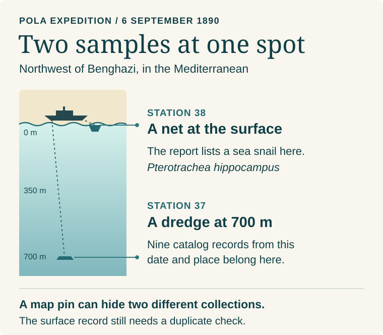

# How two ocean samples can share a map pin

On 6 September 1890 the research ship *Pola* sampled the Mediterranean northwest of Benghazi. At station 37 the crew dredged at 700 metres. At station 38 they used a surface net at the same printed coordinates. One entry in that net’s catch was a swimming sea snail, *Pterotrachea hippocampus*. Oberwimmer names station 38 in two places in the report, the table of catches and the account of this species. [Station table, printed p. 5](https://www.biodiversitylibrary.org/page/32372996) · [Species account, printed p. 14](https://www.biodiversitylibrary.org/page/32373005)

**Why the station number matters.** A researcher asking where an animal was observed in 1890 needs to know which operation found it. A match on date and coordinates alone would merge two collections made hundreds of metres apart vertically. An animal in a surface net can help document its historical range. Inferring a change in range or abundance would take many more observations and information about where and how people sampled.

**What people already did.** The historical authors published the catch, libraries scanned the pages, and MedOBIS digitized mollusc observations from another *Pola* report. We used eight of those known species–station links as a check. The pipeline recovered all eight on the evaluation page. The remaining work requires connecting a name in one part of a book to a station in another, interpreting the gear and checking modern names and duplicate publications. [MedOBIS digitization](https://doi.org/10.25607/mu0n0i) · [Scan-checked calibration](../results/calibration.json)

**What we learned.** Nine mollusc records in our Ocean Biodiversity Information System (OBIS) date-and-location check came from the deep operation. The printed surface entry is one of three cases queued for review across two stations. A museum accession or another digitization could still establish a duplicate. The public evidence packet gives the search bounds, name variants and source pages so another reader can check this conclusion. [Station 38 evidence and query coverage](../results/review_packet.json) · [Catalog response for the date and area](../data/source/obis-day-area.json)
